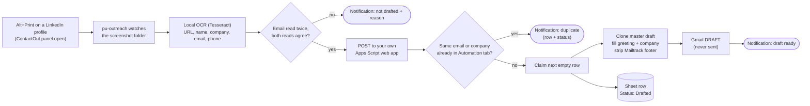

<div align="center">

# PU Outreach

**Screenshot a LinkedIn profile. Get a Sheet row and a Gmail draft. You review it. You send it.**


</div>

---

Built by the **BITS Pilani Placement Unit** and open for any placement cell or outreach team to fork and adapt. Inviting a company to campus placements used to mean hunting
for a contact on LinkedIn, copying the details into a tracker, and pasting the same email again. This tool
turns that into one keypress, and keeps a human in charge of every email that goes out.

| You do | The tool does |
|---|---|
| Browse LinkedIn as usual, open a profile, open the ContactOut panel | Nothing. It never touches LinkedIn. |
| Press the screenshot key (<kbd>Alt</kbd>+<kbd>Print</kbd> on GNOME) | Reads the screenshot locally, checks for duplicates, writes the Sheet row, clones your master email into a **draft**, and shows a notification |
| Open Gmail, read the draft, click **Send** | Nothing. It cannot send. |

## What one capture produces

A screenshot of a (fictional) profile becomes:

| Field | Taken from | Example |
|---|---|---|
| LinkedIn | address bar | `https://www.linkedin.com/in/riya-fakename-4b2a1c/` |
| POC | ContactOut panel (cross-checked with the profile header) | Riya Fakename |
| Email | ContactOut panel, **read twice, both reads must agree** | riya.fakename@examplelogix.test |
| Mobile | ContactOut panel | +91 98765 43210 |
| Company | profile card, logo excluded | Examplelogix (Example Logistics Solutions Pvt. Ltd.) |
| Greeting | first name, via aggregate name data | `Dear Riya ma'am,` or `Dear Team,` |
| Draft | your master draft, cloned | subject `Invitation - Examplelogix \| BITS Pilani…`, both attachments |
| Status | fixed | `Drafted` |

Anything uncertain is left blank or flagged in **Remarks**. The tool never guesses.

## How it works



Why a screenshot? On GNOME/Wayland (Ubuntu 26.04) apps cannot watch the clipboard or read other windows'
titles, so those designs do not work there. A screenshot works on every OS, needs no browser extension, and
automates nothing on LinkedIn.

## Guardrails

| Promise | How it is kept |
|---|---|
| **Never sends email** | The web app only calls `GmailApp.createDraft`. There is no send call anywhere in the code. |
| **Writes only the `Automation` tab** | The script opens that tab by name. `Leads` is never read or written. |
| **Never touches LinkedIn** | No extension, no automated clicks or scrolling. It reads screenshots you take yourself. |
| **Nothing leaves your control** | OCR runs locally. Each member deploys their *own* web app under their *own* Google account. |
| **Your web app is not open to the world** | It answers only requests carrying your secret token. |
| **No duplicate pitches** | Same email, or same company after normalising spelling, blocks the draft and tells you who and where. |
| **Uncertain means blank** | Unclear email → no draft. Unclear greeting → `Dear Team,`. Everything else → a note in Remarks. |

## Quick start

> Full click-by-click version for teammates: **[TEAM_GUIDE.md](TEAM_GUIDE.md)**. About 30 minutes, once.

### 1. Install the app

```bash
# Ubuntu / Debian
sudo apt install tesseract-ocr libnotify-bin
curl -LsSf https://astral.sh/uv/install.sh | sh        # installs uv; reopen the terminal afterwards

git clone <this-repo-url> && cd pu-outreach
uv tool install .
pu-outreach --version
```

macOS: `brew install tesseract`. Windows: install Tesseract from the
[UB-Mannheim builds](https://github.com/UB-Mannheim/tesseract/wiki). Both are **untested** (see [status](#what-has-been-verified)).

### 2. Names data (for ma'am / sir)

If `pu_outreach/data/names.json.gz` is in the repo, skip this. Otherwise, once per computer:

```bash
uv tool run --from . --with pyarrow pu-outreach build-names
```

Without it, every greeting safely falls back to `Dear Team,`.

### 3. Prepare your master draft in Gmail

Make one draft, with **To left empty**, both attachments, and your signature:

- Subject: `[PU-MASTER] Invitation - {{Company}} | BITS Pilani, Pilani Campus Placement Season 2026-27`
- First line of the body: `{{Greeting}}`
- In the invitation sentence: `…we are excited to invite {{Company}} to participate…`

Type each `{{…}}` in plain text in one go (no bold inside it; paste with <kbd>Ctrl</kbd>+<kbd>Shift</kbd>+<kbd>V</kbd>).
Never send this draft. Exactly one draft may start with `[PU-MASTER]`.

### 4. Create your web app (Apps Script)

1. [script.google.com](https://script.google.com) → **New project**.
2. Gear → tick **Show "appsscript.json"**; paste `apps_script/appsscript.json` into it.
3. Paste `apps_script/Code.gs` into `Code.gs`. Set `SHEET_ID` (the part of the Sheet URL between `/d/` and `/edit`).
4. Run **`setupToken`** once, approve the permissions (Google warns the app is unverified because it is yours: *Advanced → Go to … → Allow*), and copy the token from the **Execution log**.
5. **Deploy → New deployment → Web app**: *Execute as* **Me**, *Who has access* **Anyone**. Copy the `/exec` URL.

> **"Anyone" only means no Google login is required.** Without your token every request is refused.
>
> **Updating later:** *Deploy → Manage deployments → ✏️ → Version: New version.* Never use *New deployment* again,
> it creates a different URL. Keep exactly one active deployment.

### 5. Connect and check

```bash
pu-outreach setup          # web-app URL, token, screenshot folder
pu-outreach doctor         # every line should be ✔
```

<details>
<summary>What a healthy <code>doctor</code> looks like (example)</summary>

```text
This computer
 ✔ Python: 3.14.4
 ✔ Tesseract OCR: tesseract 5.5.0
 ✔ Screenshot folder: /home/you/Pictures/Screenshots
 ✔ Notifications: notify-send
 ✔ Names data (for ma'am/sir): 40,581 names
 ✔ Config: /home/you/.config/pu-outreach/config.json

Your web app (Apps Script)
 ✔ Reachable: running as you@your-domain
 ✔ Sheet + Automation tab: PU Outreach Tracker
 ✔ Headers A–H: # | Company | POC | Email | Mobile | LinkedIn | Status | Remarks
 ✔ Status option "Drafted": Drafted, Mailed, JAF Received, Not Hiring, …
 ✔ Status option "Mailed"
 ✔ Web app code version: 0.1.4
 ✔ Master draft found: [PU-MASTER] Invitation - {{Company}} | BITS Pilani, …
 ✔ Body has {{Greeting}}
 ✔ Body has {{Company}}
 ✔ Attachments: JAF Placements 2026-27.docx (5.6 MB), Placement Brochure 2026-27.pdf (7.4 MB)
 ✔ Total size under 25 MB: 13.0 MB
 ✔ Inline images: 0 found in master, NOT copied (basic mode)
 ✔ Mailtrack footer in saved draft: yes — will be removed from copies

All good.
```

</details>

### 6. Try it safely, then go live

```bash
pu-outreach try ~/Pictures/Screenshots/some-profile.png --server   # dry run: nothing is written
pu-outreach try ~/Pictures/Screenshots/some-profile.png --draft    # real: writes a row + creates a draft
pu-outreach autostart enable                                       # start at every login
```

Test first on a **copy** of the Sheet (set its ID in `SHEET_ID`), then switch to the real one and redeploy.
A real `--draft` creates a draft addressed to that person: never send a test draft to them.

## Daily use

1. Open a LinkedIn profile and open the ContactOut panel so the email is visible. Keep the browser **out of fullscreen** so the address bar shows.
2. Press the screenshot key (GNOME <kbd>Alt</kbd>+<kbd>Print</kbd>, Windows <kbd>Win</kbd>+<kbd>PrtScn</kbd>, macOS <kbd>Cmd</kbd>+<kbd>Shift</kbd>+<kbd>3</kbd>).
3. A notification tells you what happened:

```text
draft ready   Examplelogix → Dear Riya ma'am, riya.fakename@examplelogix.test  (row 7)
duplicate     Examplelogix already in row 3 (same company, status: Drafted)
not drafted   email unclear (two reads disagree: a@x.test / a@xx.test)
```

4. Open Gmail → Drafts, read it, **Send**. Mailtrack tracks it as usual because it adds its footer when *you* send.

## Commands

| Command | What it does |
|---|---|
| `pu-outreach setup` | Guided setup: name, web-app URL, token, screenshot folder. Ends with `doctor`. |
| `pu-outreach doctor [--notify]` | Checks this computer, your web app, the Sheet and the master draft, with a plain-English fix per problem. |
| `pu-outreach run` | Watch the screenshot folder in the foreground (<kbd>Ctrl</kbd>+<kbd>C</kbd> stops it). |
| `pu-outreach autostart enable \| disable` | Start at login: systemd user service, launchd, or Windows Startup. |
| `pu-outreach stop` | Stop the background watcher. |
| `pu-outreach try IMG [--debug] [--server] [--draft]` | Read one screenshot and show what would be saved. `--server` is a dry run, `--draft` is real. |
| `pu-outreach greet NAME` | Show the greeting a name would get, and why. |
| `pu-outreach stats` | Measurement summary (see below). |
| `pu-outreach build-names` | Download the first-name data used for greetings. |

Config lives outside the repo: `~/.config/pu-outreach/` on Linux, `~/Library/Application Support/pu-outreach/` on macOS, `%APPDATA%\pu-outreach\` on Windows. It contains your token, so it is created with owner-only permissions.

## The Sheet contract

Only the **Automation** tab, columns A–H, unchanged. A capture goes into the first row (from row 2) whose **Company** is empty.

| Col | Written | Notes |
|---|---|---|
| A `#` | row − 1 | matches the pre-filled 1, 2, 3 |
| B Company | full name as on LinkedIn | the email body uses the short form |
| C POC | name only | |
| D Email | the address read from ContactOut | |
| E Mobile | `+91 XXXXX XXXXX`, stored as text | stops Sheets turning it into a number |
| F LinkedIn | profile URL | |
| G Status | `Drafted` | optional sent-checker flips it to `Mailed` |
| H Remarks | short flags | see below |

<details>
<summary>Remarks you may see</summary>

| Remark | Meaning |
|---|---|
| `greeting: ma'am (97% female in data) — check` | The tool chose a gendered greeting from name data. Glance at it. |
| `greeting: Team (ambiguous …)` / `(name not in data)` | Fell back to `Dear Team,`. |
| `company taken from email domain — check` | The company was not readable on the page. |
| `email domain differs from company — check` | Allowed, but worth a look. |
| `personal email` | e.g. a Gmail address. |
| `other email(s): …` | ContactOut showed several; the work address was used. |
| `check LinkedIn URL` | The URL was read with low agreement or does not match the name. |
| `LinkedIn URL not visible` | Address bar hidden (fullscreen?). |
| `needs POC name` / `needs company` | Left blank; fill by hand. |
| `phone unclear — left blank` | The two OCR reads disagreed. |
| `company may be a school/university — check` | The card showed an education line. |

</details>

## Greeting rules

`Dear <First> ma'am,` or `Dear <First> sir,` **only** when the first name is clearly one way. Everything else is `Dear Team,`. There is never a bare `Dear Riya,`.

- ≥ 95% of people with that first name are female → ma'am; ≤ 5% → sir.
- A title in the name (`Ms.`, `Mrs.`, `Mr.`) decides directly.
- Unknown, ambiguous (Kiran, Sonu…), or non-English letters → `Team`.
- Photos are never used.

The data is [naampy](https://github.com/appeler/naampy)'s first-name lookup (counts of female/male electoral-roll records per first name; source dataset CC0, naampy code MIT). To correct a name, add it to `names_override.json` in the config folder:

```json
{ "kiran": "maam", "sonu": "team" }
```

## Duplicate protection and the race condition

Before drafting, the web app checks the Automation tab for the **same email** (case-insensitive) or the **same company**, normalised: case, spaces, punctuation, bracketed text, and *Pvt Ltd / Private Limited / Ltd / Inc / LLP / Corp* are ignored. `Leads` is not read.

If two members capture the same company at the same moment, each member's script writes its row, waits about a second, re-reads, and the **earlier row wins**; the other clears its row and reports a duplicate. This catches near-simultaneous captures. It is **not a hard guarantee**: each member has their own script, so Apps Script locks cannot span them.

## What has been verified

| Claim | Status |
|---|---|
| End to end on the maintainer's machine: Ubuntu 26.04, GNOME 50 Wayland, snap Chromium, BITS Google Workspace — screenshot → correct Sheet row and draft | **Fact** (one machine, one master draft, reported by the maintainer) |
| GNOME Wayland blocks clipboard watching and window titles; Alt+Print saves to `~/Pictures/Screenshots` | **Fact** |
| Whole-page OCR misses the ContactOut panel; OCR of the cropped panel reads email and phone exactly | **Fact** |
| An Apps Script web app with *Anyone* access works for a BITS account | **Fact** (maintainer's account) |
| 27 Python tests + 11 JS tests pass, on fake data only (dark/light theme, no email, missing company, personal email, non-English names, duplicates, spelling variants, a fake Apps Script server with the real redirect behaviour) | **Fact** |
| Draft clone keeps body, links, signature text and both attachments | **Fact** (maintainer's master) |
| Inline (embedded) images are **not** copied | **Fact**, by design in the default reader. The maintainer's master has 0, so nothing was lost. |
| An experimental "advanced" reader that copies inline images | **Disabled.** It returned wrong sizes in its first real test. |
| Mailtrack tracks a cloned draft once you send it | **Assumption**, not yet confirmed |
| Light theme, other screen sizes | **Untested** on real screenshots |
| macOS and Windows (OCR path, notifications, autostart) | **Untested** until a teammate confirms |
| Teammates' Workspace accounts allow *Anyone* web apps | **Unknown**, each person finds out at deploy time |

## Known limits

- **Gmail:** 25 MB per message (the current two attachments are about 13 MB). Each draft stores its own copy of the attachments in your mailbox, so unsent drafts add up (100 drafts ≈ 1.3 GB). Send or delete the ones you do not need.
- **Apps Script:** 6 minutes per run (a draft takes seconds). Daily quotas are far above a few hundred drafts a day for Workspace accounts; verify on Google's quota page.
- **OCR:** local, free, about 2–4 seconds per screenshot. Very small or zoomed-out pages, and fullscreen browsers (no address bar), reduce accuracy.
- **LinkedIn and ContactOut have their own terms.** This tool reads screenshots you take yourself and automates nothing on LinkedIn, but LinkedIn's rules still restrict copying member data. Use it only for placement outreach, at human volumes.

## Troubleshooting

<details>
<summary><code>web app returned HTTP 404</code></summary>

The deployment behind your saved URL no longer exists (usually after *New deployment* or archiving). In Apps Script: *Deploy → Manage deployments*, copy the **active** deployment's URL, run `pu-outreach setup`, paste it. Opening the URL in a browser should show `PU Outreach drafter is running. Use POST.`
</details>

<details>
<summary><code>Web app code version</code> is older than expected</summary>

You updated `Code.gs` but did not publish it. *Deploy → Manage deployments → ✏️ → Version: New version → Deploy*. Pasting a new `Code.gs` also resets `SHEET_ID` to the placeholder, so set it again first.
</details>

<details>
<summary><code>Body has {{Greeting}}</code> / <code>{{Company}}</code> shows ✖</summary>

Gmail split the placeholder with formatting. The doctor prints the HTML around it. Delete the placeholder, retype it in one go in plain text, and re-run `doctor`.
</details>

<details>
<summary>"email unclear" or "no email found"</summary>

The two OCR reads disagreed, or the panel was not showing an email. Make sure ContactOut's panel is open with the email visible, the page is not zoomed far out, then take the screenshot again.
</details>

<details>
<summary>Nothing happens after the screenshot key</summary>

Run `pu-outreach doctor --notify`. On Linux check the watcher with `systemctl --user status pu-outreach`. Confirm the screenshot actually lands in the folder `doctor` lists, and that the profile's address bar is visible. Non-LinkedIn screenshots are ignored silently by design.
</details>

## Measuring the impact

`pu-outreach stats` summarises a local log (`metrics.csv`, no names, emails or phone numbers): captures, drafts, duplicates blocked, median seconds from screenshot to draft, and drafts per active hour. If you run the optional sent-checker (`installSentChecker` once in Apps Script), it also counts drafts sent unedited vs edited.

The manual baseline was **~58 minutes for 5 companies (~11.6 min each, including vetting), n = 1**. The tool does not speed up vetting. A before/after comparison is **pending real re-timing**; no improvement is claimed here.

## Using this for your own team

This repo contains **no** Sheet IDs, tokens, recruiter data or email templates. Everything specific to you is yours: your own Sheet and `Automation` tab (headers A–H as above), your own master draft, your own Apps Script deployment. Edit the greeting wording in `names.py` and the sheet columns in `Code.gs` `CONFIG` to fit your process. You are responsible for following LinkedIn's and ContactOut's terms and the privacy law that applies to you; this tool is not legal advice.

## Privacy

Only what placement outreach needs is stored: a recruiter's name, work email, phone, LinkedIn URL and company, in the team Sheet and in the capturing member's own Gmail drafts. Screenshots stay on your computer (and can be auto-deleted after a successful draft). OCR is local. See **[PRIVACY.md](PRIVACY.md)** for deletion on request and a plain-language note on India's DPDP Act (general information, not legal advice). Keep the Sheet shared with the Placement Unit only.

## Project layout

```text
apps_script/
  Code.gs               the web app: dedupe, row claim, draft clone, doctor, sent-checker
  appsscript.json       manifest: scopes and web-app settings
pu_outreach/
  ocr.py                screenshot → fields (crop, two reads, agreement check)
  extract.py            pure text parsing: email, phone, URL, names, company
  names.py              first name → ma'am / sir / Team
  pipeline.py           watcher + orchestration + notifications
  client.py             talks to your Apps Script web app
  cli.py                setup, doctor, run, try, stats, greet, autostart, stop
  autostart.py          systemd / launchd / Windows Startup
  metrics.py            local, personal-data-free measurement log
tests/                  Python tests (fake screenshots) + JS tests for Code.gs
```

## Development

```bash
uv venv && uv pip install -e ".[dev]"
pytest                          # needs tesseract on PATH
node tests/js/test_code.mjs     # tests the pure helpers in Code.gs
```

Test fixtures are generated fake screenshots; no real person's data is in this repo.
The place to plug in a small local model (for example Ollama) later is `pipeline.build_payload()`. v1 is template-only on purpose.

## Roadmap

- [ ] Internship variant: one master draft with a single `{{IAF}}` token plus a second attachment (designed, parked)
- [ ] Copy inline images when a master uses them
- [ ] Contributions welcome: macOS/Windows confirmation reports, OCR fixes with *fake* test screenshots (never real people's data)
- [ ] Confirm macOS and Windows with teammates
- [ ] Confirm Mailtrack on cloned drafts; optional sent-checker rollout
- [ ] Light-theme and multi-resolution OCR test set from real screenshots

## Credits

[Tesseract OCR](https://github.com/tesseract-ocr/tesseract) · [Pillow](https://python-pillow.org/) · [naampy](https://github.com/appeler/naampy) (MIT; first-name data from Indian electoral rolls, [Harvard Dataverse](https://doi.org/10.7910/DVN/WZGJBM), CC0).

## License

[MIT](LICENSE).
